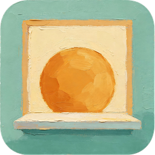
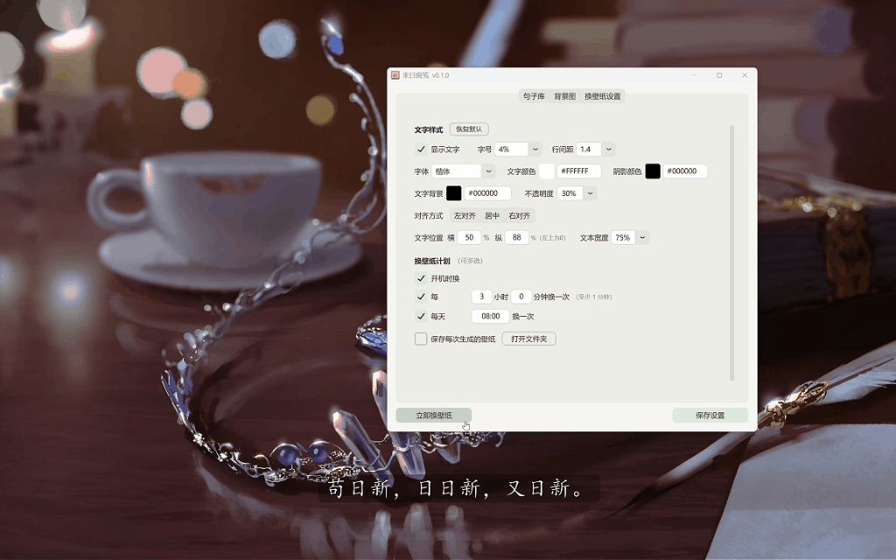

[简体中文](README.md) | **English**

# HopeCasement 来日窗笺

Turn your favorite lines and backgrounds into Windows wallpapers that change on a schedule.

[Download the installer](https://github.com/jc371115833-cmd/hope-casement/releases) · [User guide (Chinese)](docs/index.md) · [Report a problem](https://github.com/jc371115833-cmd/hope-casement/issues) · [Contribute](CONTRIBUTING.en.md)

Install on Windows 10 or 11, open HopeCasement, and click **Change Now** to try the built-in quotes and solid background. Add your own lines and images, then adjust the font, color, shadow, alignment, and position.

For automatic changes, choose a sign-in, interval, or daily schedule on the **Wallpaper** tab and click **Save**. You can close the window. Windows will launch the app at the scheduled time to generate a wallpaper and exit.

Released under the [MIT license](LICENSE).
