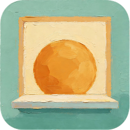
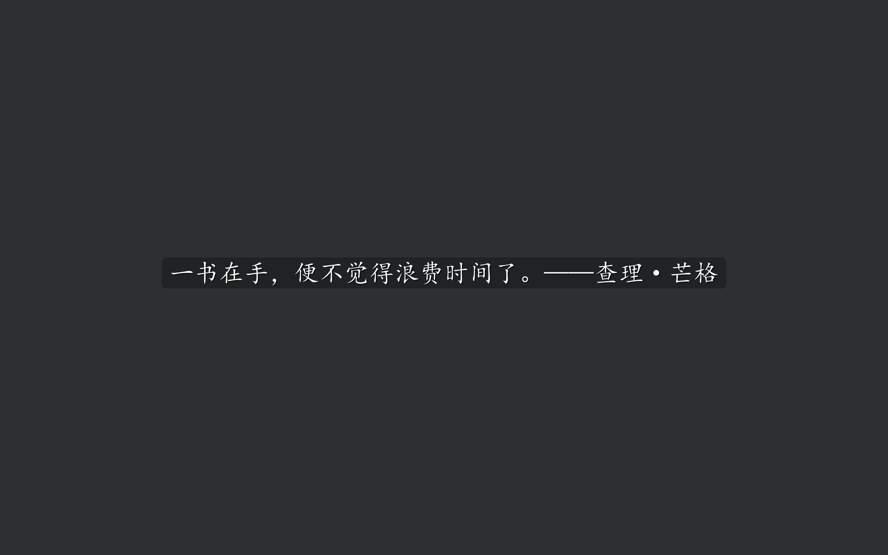

# 来日窗笺 HopeCasement

**定时把你的句子和背景随机组合，自动换成桌面壁纸**

> 改变一个人，有时候一句话就够了

***

## 为什么选择来日窗笺

> 想要的很简单：让喜欢的句子随机落在喜欢的壁纸上，日日更新——抬眼是窗，落字成笺，对来日满怀希望。

> 古人书箴言于笺、贴于窗，抬目自省。本软件以「窗」喻屏幕，以「笺」作壁纸，每日择良言铺于桌面，奔赴来日。

***

## 功能特点

- 🖼️ **随机组合** —— 句子库 + 背景（图片或纯色）随机搭配，每次都不一样
- ✍️ **句子自定义** —— 励志名言、诗词、自己写的话，随你放
- ⏰ **定时自动换** —— 开机换、每天定时、或每隔几小时，设了就不用管
- 🎨 **样式可调** —— 字号、颜色、位置、阴影，按喜好设置
- 🔒 **纯本地** —— 不联网、不注册、不收费、无广告，不上传任何东西

<!-- 截图占位：把界面截图发我，我帮你按「功能点 + 配图」的版式插进这里 -->

***

## 使用

前往 [Releases](../../releases) 下载安装包，双击安装（无需管理员权限）。打开后添加句子、选好背景、设定换壁纸频率，之后它会在后台自动运行。

> 仅支持 Windows 10 / 11。背景图请确保你拥有合法使用权，可从 [Unsplash](https://unsplash.com)、[Pexels](https://pexels.com)、[Pixabay](https://pixabay.com) 等免费图库获取。

***

## 参与开发

从源码运行、项目结构与贡献方式见 [CONTRIBUTING.md](CONTRIBUTING.md)。欢迎提 [Issue](../../issues) 或 Pull Request。

***

本项目采用 [MIT](LICENSE) 许可证 · © 2026 KingKing
