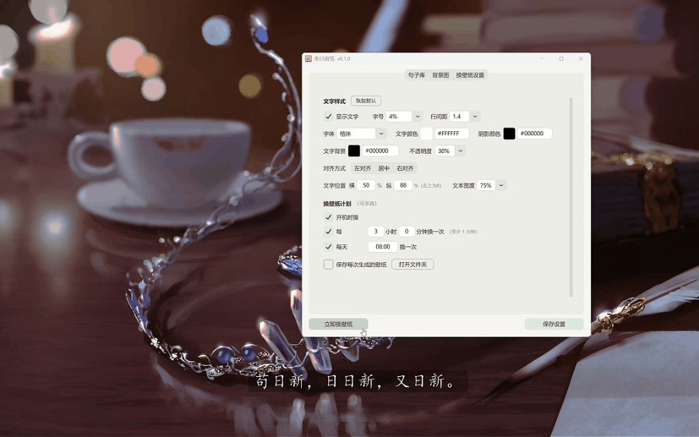
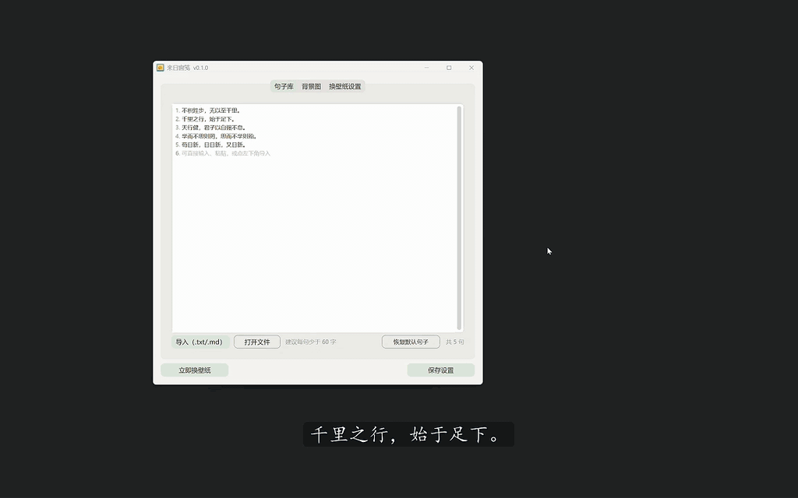
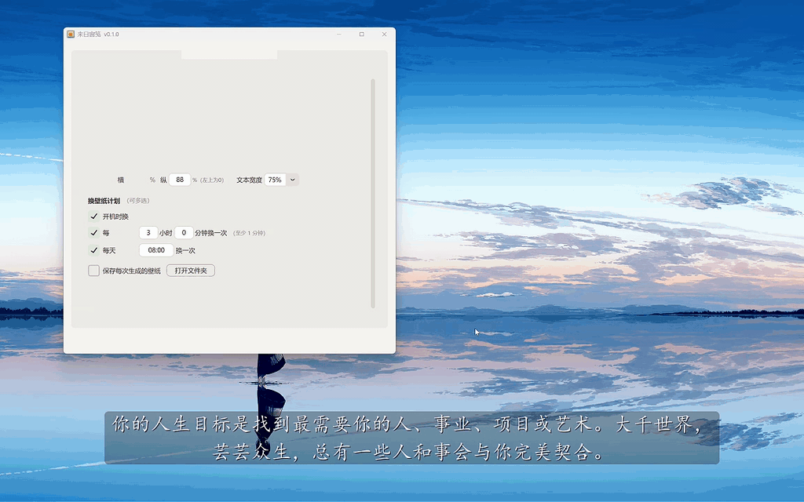

# 来日窗笺 HopeCasement

**定时随机组合你的句子和背景，自动换成桌面壁纸**

## 为什么选择来日窗笺

因为简单，让喜欢的句子随机落在不同的壁纸上，定时更新。轻量、不占后台，无感使用。

## 功能特点

**🎲 随机组合** —— 你的句子 × 背景（图片或纯色），每次随机

 

**✍️ 句子与背景自定义** —— 输入、粘贴或导入句子；导入中意的图片或简洁纯色作背景

 

**🎨 样式可定制** —— 字体、颜色、阴影、对齐、位置可调

 

**⏰ 定时自动换** —— 开机 / 定时 / 固定时间

> 不占后台，定时运行一次。
## 快速开始

前往 [Release 页](../../releases) 下载安装包

> 目前仅支持 Windows 10 / 11

## 参与开发

见 [CONTRIBUTING.md](CONTRIBUTING.md)

***

本项目采用 [MIT](LICENSE) 许可证 · © 2026 KingKing
