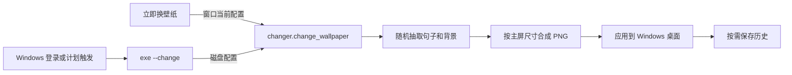

# 一次换图经过哪些模块

[程序入口](../../src/hopecasement/__init__.py)有两条路径。直接打开程序会启动配置窗口。带 `--change` 启动时直接读取已保存的设置并换图。Windows 登录项和任务计划程序都调用后一条路径，配置窗口可以关闭。

`render_wallpaper()` 读取主屏尺寸，调用 `compose_wallpaper(background, quote, cfg, size)` 获得 RGB 图像，再写出当前壁纸。传入指定尺寸可以独立复现裁剪和排版。桌面设置成功后，`changer` 才会归档。由计划启动的进程遇到换图异常时，入口会尝试向数据目录的 `error.log` 追加堆栈。

窗口里的 **立即换壁纸** 会保存句库，再把当前控件值交给工作线程处理这一次换图。**保存设置** 和关闭窗口时确认保存则共用 `App._save()`，先保存句库和配置，再应用 Windows 调度。打包版调度注册失败时，配置已写入，窗口提示并允许再次点击保存。三个动作分别用[换图测试](../../tests/test_change_flow.py)与[保存测试](../../tests/test_save.py)验证。

## 按改动定位

| 任务 | 先读的代码 | 验证与相关手册 |
| --- | --- | --- |
| 改文字显示或背景裁剪 | [样式控件](../../src/hopecasement/ui/tab_schedule.py)、[Pillow 合成](../../src/hopecasement/renderer.py) | [渲染测试](../../tests/test_renderer.py)、[样式手册](../user-guide/text-style/format-text.md) |
| 改背景来源或图片导入 | [背景页](../../src/hopecasement/ui/tab_images.py)、[背景抽取](../../src/hopecasement/image.py) | [换图流程测试](../../tests/test_change_flow.py)，导入与选目录按[背景手册](../user-guide/backgrounds/images-and-colors.md)走查 |
| 改句库导入、存储或抽句 | [句库编辑页](../../src/hopecasement/ui/tab_quotes.py)、[句库存储](../../src/hopecasement/quotes.py) | 在临时样本中按[句库手册](../user-guide/quotes/manage-quotes.md)核对导入、保存、重读 |
| 改保存、登录项或时间计划 | [窗口回调](../../src/hopecasement/ui/app.py)、[计划控件](../../src/hopecasement/ui/tab_schedule.py)、[系统调度](../../src/hopecasement/scheduler.py) | [保存测试](../../tests/test_save.py)、[调度测试](../../tests/test_scheduler.py)、[验证自动更换](../user-guide/scheduling/automatic-changes.md) |
| 改桌面调用或历史归档 | [换图流程](../../src/hopecasement/changer.py)、[Windows 桌面调用](../../src/hopecasement/wallpaper.py) | [换图流程测试](../../tests/test_change_flow.py)、[手动换图排障](../troubleshooting/wallpaper-not-changing.md) |
| 改配置字段、数据位置 | [配置与迁移](../../src/hopecasement/config.py)、[安装与卸载](../../setup/Hopecasement.iss) | [迁移回归](../../tests/test_config_migration.py)、[数据兼容约定](configuration-and-data.md) |
| 改入口、界面文案或安装资源 | [入口声明](../../pyproject.toml)、[双语文案](../../src/hopecasement/i18n.py)、[打包资源](../../HopeCasement.spec) | [打包与安装验收](../development/release.md)；同时核对中英文入口 |

## Windows 调度边界

登录项写入当前用户注册表的 `Run` 键。间隔和每日任务分别生成 XML，通过 `schtasks` 注册。每次保存按所选模式更新或清理相应的系统入口。启动时的 Windows 用户、exe 路径、配置文件所在目录共同决定任务能读取哪些素材。定位计划问题时，从[注册、触发和执行](../troubleshooting/schedule-not-running.md)三步查起。
