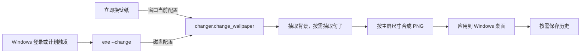

# 一次换图经过哪些模块

[程序入口](../../src/hopecasement/__init__.py)有两条路径。直接打开程序会启动配置窗口。带 `--change` 启动时直接读取已保存的设置并换图。Windows 登录项和任务计划程序都调用后一条路径，配置窗口可以关闭。

`compose_wallpaper()` 接受指定尺寸，可以独立复现裁剪和排版。`render_wallpaper()` 提供主屏尺寸并写出 PNG。手动换图与系统任务在同一 Windows 会话内依次写出图片、设置桌面、按需归档，防止两个请求相互覆盖。计划换图遇到异常时，`--change` 会尝试向数据目录的 `error.log` 追加堆栈，并以状态码 1 退出。

窗口里的 **立即换壁纸** 会保存句库，再把当前控件值交给工作线程处理这一次换图。**保存设置** 和关闭窗口时确认保存共用 `App._save()`，先保存句库和配置，再应用 Windows 调度。打包版调度更新失败时，配置已写入。窗口保留待重试状态，再次保存或关闭时确认重试会重新登记计划，选择直接退出则保留已写入的配置。

## 按改动定位

| 任务 | 先读的代码 | 验证与相关手册 |
| --- | --- | --- |
| 改启动行为、重复打开窗口或计划进程 | [main 入口](../../src/hopecasement/__init__.py)、[窗口初始化](../../src/hopecasement/ui/app.py)、[窗口单实例](../../src/hopecasement/single_instance.py) | [两条换图路径](../../tests/test_change_flow.py)、[源码启动](../development/local-setup.md) |
| 改文字显示或背景裁剪 | [样式控件](../../src/hopecasement/ui/tab_schedule.py)、[Pillow 合成](../../src/hopecasement/renderer.py) | [渲染测试](../../tests/test_renderer.py)、[样式手册](../user-guide/text-style/format-text.md) |
| 改背景来源或图片导入 | [背景页](../../src/hopecasement/ui/tab_images.py)、[背景扫描与抽取](../../src/hopecasement/image.py) | [素材测试](../../tests/test_content.py)、[背景手册](../user-guide/backgrounds/images-and-colors.md) |
| 改句库编辑、导入或抽句 | [句库编辑页](../../src/hopecasement/ui/tab_quotes.py)、[句库存储](../../src/hopecasement/quotes.py) | [素材测试](../../tests/test_content.py)、[句库手册](../user-guide/quotes/manage-quotes.md) |
| 改保存、登录项或时间计划 | [窗口回调](../../src/hopecasement/ui/app.py)、[计划控件](../../src/hopecasement/ui/tab_schedule.py)、[系统调度](../../src/hopecasement/scheduler.py) | [保存测试](../../tests/test_save.py)、[调度测试](../../tests/test_scheduler.py)、[验证自动更换](../user-guide/scheduling/automatic-changes.md) |
| 改桌面调用或历史归档 | [换图流程](../../src/hopecasement/changer.py)、[Windows 桌面调用](../../src/hopecasement/wallpaper.py) | [换图流程测试](../../tests/test_change_flow.py)、[历史测试](../../tests/test_history.py)、[手动换图排障](../troubleshooting/wallpaper-not-changing.md) |
| 改配置字段、写盘方式或数据位置 | [配置与迁移](../../src/hopecasement/config.py)、[文件写入](../../src/hopecasement/storage.py)、[安装与卸载](../../setup/Hopecasement.iss) | [迁移测试](../../tests/test_config_migration.py)、[数据兼容约定](configuration-and-data.md)、[备份与恢复](../user-guide/data/backup-and-restore.md) |
| 改界面语言或显示文案 | [语言与翻译](../../src/hopecasement/i18n.py)、[安装语言登记](../../setup/Hopecasement.iss) | 按[安装版验收](../development/release.md#安装版验收)核对中、英文显示 |
| 改版本、入口声明、图标或打包资源 | [包元数据](../../pyproject.toml)、[PyInstaller 配置](../../HopeCasement.spec)、[安装脚本](../../setup/Hopecasement.iss) | [Windows CI](../../.github/workflows/ci.yml)、[构建与发布](../development/release.md) |

## Windows 调度边界

登录项写入当前用户注册表的 `Run` 键。间隔和每日任务分别生成 XML，通过 `schtasks` 注册。每次保存按所选模式更新或清理相应的系统入口。启动时的 Windows 用户、exe 路径、配置文件所在目录共同决定任务能读取哪些素材。定位计划问题时，从[注册、触发和执行](../troubleshooting/schedule-not-running.md)三步查起。
