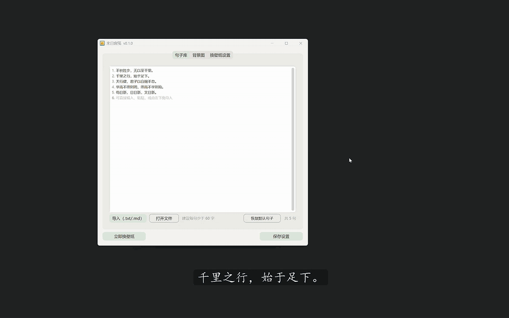

# 管理图片和纯色背景

「背景图」上半部分管理颜色，下半部分显示当前图片目录及图片数量。每个颜色和每张图片都是一个候选项。例如有一种纯色和三张图片时，每项各有四分之一的机会被选中。

## 使用自己的图片

1. 在「图片背景」点「更换文件夹」可直接使用已有照片目录。点「添加图片」则将选中的文件复制到界面显示的目录。来自其他目录的同名图片会在文件名末尾加上序号，例如 `海边 (1).jpg`，两张图都能保留。
2. 将要参加随机选取的图片放在该目录的第一层。支持 PNG、JPG、JPEG、BMP 和 GIF。可点「打开文件夹」核对内容，再回到窗口查看「共几张」。
3. 想让桌面只轮换照片时，先确认至少有一张图片，再点击各个色块下的「删除」。点击「立即换壁纸」观察效果，最后点「保存设置」保留所选目录和颜色。

程序会先按照片记录的拍摄方向摆正画面，再按主屏比例等比缩放、居中裁剪。要保留照片边缘的主体，可预先按主屏比例裁一份副本。

## 使用纯色背景

点「添加颜色」，可选择推荐配色、输入十六进制色值（如 `#203040`），或点「自定义颜色…」。若想固定一种纯色，保留一个色块，用「更换文件夹」选择一个空文件夹即可。切换文件夹只更改图片来源，原目录里的照片仍在原处。

[调整文字样式](../text-style/format-text.md) · [文档索引](../../index.md)
