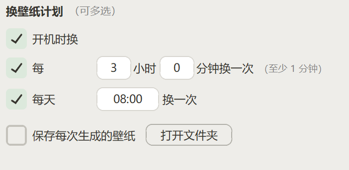

# 设置和验证自动换壁纸

使用安装版，在「换壁纸设置」的「换壁纸计划」勾选需要的触发方式。Windows 会在指定时机运行一次换图程序，平时可以关闭窗口。源码运行可调试手动换图，注册自动计划需要打包后的 `HopeCasement.exe`。

| 界面选项 | 何时触发 |
| --- | --- |
| 开机时换 | 当前 Windows 用户登录后换一次。可在任务管理器的启动应用中查找 HopeCasement。 |
| 每 … 小时 … 分钟换一次 | 按所填间隔重复触发。小时和分钟都填 0 时，按最短间隔 1 分钟执行。 |
| 每天 … 换一次 | 按本机时间每天运行一次，使用 24 小时制。`9:30` 会显示为 `09:30`。启用每日计划时，输入 `25:10` 等无效时间会提示修改，原计划继续生效。 |

三项可以组合。全新配置的界面默认勾选三项；首次保存计划后才会按勾选结果注册。

## 试一次每日定时

1. 为了容易判断触发来源，只勾「每天」，填今天接下来几分钟内的时间。点击「保存设置」，确认窗口显示「✓ 已保存」。从有修改的窗口退出时，选择「是」保存也会应用计划。
2. 打开 Windows「任务计划程序」，在「任务计划程序库 → HopeCasement」找到 `ChangeAtTime`，核对「下次运行时间」。间隔计划在同一位置，名称为 `ChangeOnInterval`。
3. 关闭配置窗口，保持电脑唤醒、当前用户登录。到点后看桌面，再核对任务的「上次运行时间」以及数据目录中 `current_wallpaper.png` 的修改时间。抽到相同素材时，后两项仍可用于核对。[找到数据目录](../data/backup-and-restore.md)
4. 打开窗口，改回日常需要的时间并保存。只想手动更换时，取消三个选项，点击「保存设置」；可回到任务计划程序与启动应用核对相应条目。

「立即换壁纸」只触发本次换图。系统中的计划依据保存时的选项更新。保存时报错或到点无变化时，按注册、触发、执行的顺序检查。[手动能换，定时没有变化](../../troubleshooting/schedule-not-running.md) · [文档索引](../../index.md)
