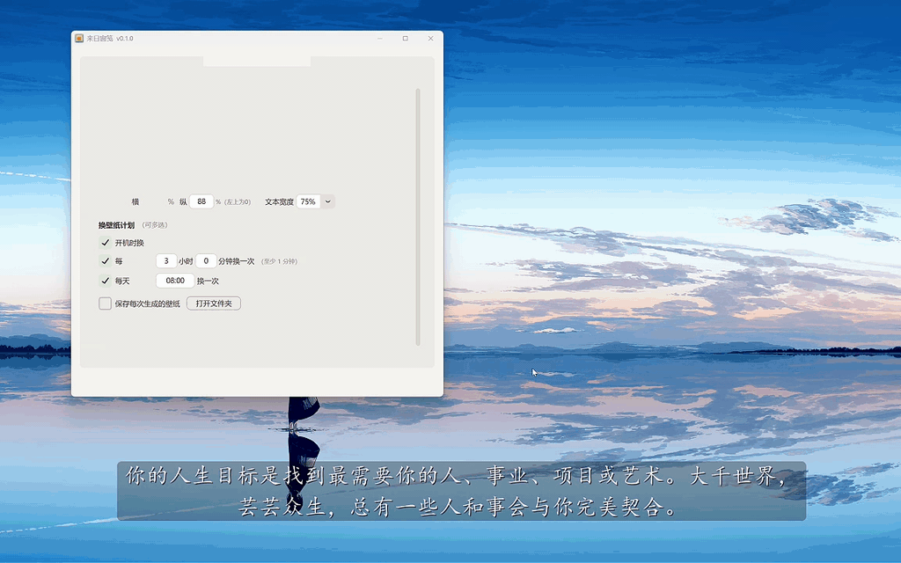

# 调整字体、位置和文字底色

在「换壁纸设置」找到「文字样式」，勾选「显示文字」。如果想只比较两种样式，可以暂用同一句子和同一背景。每次点击「立即换壁纸」，桌面就会显示当前效果。

| 想调整的效果 | 操作 |
| --- | --- |
| 文字大小 | 选「字体」和「字号」。字号按主屏画布高度计算，例如 1080 像素高的画布用 4% 约为 43 像素。字体菜单会随本机已安装的字体而变化。 |
| 每行字数和行间空间 | 缩小「文本宽度」会让长句提前换行。「行间距」按字号的倍数设置，调大会拉开两行之间的距离。 |
| 整段文字的位置 | 「文字位置」的横、纵数值是文字块中心占画布宽、高的百分比。例如横 50、纵 80 表示水平居中、靠近屏幕下方。靠近边缘时会留出边距。 |
| 多行文字的排列 | 用「对齐方式」调整各行在文字块里的位置。移动整段文字请用「文字位置」。 |
| 亮色照片上的可读性 | 调「文字颜色」「阴影颜色」或「文字背景」。将底色设为黑色，调高「不透明度」可以压暗文字后方；设为 0% 可去掉底色。 |

满意后点「保存设置」，使下次启动和自动换壁纸沿用此样式。「恢复默认」也会恢复本页的换壁纸计划与历史保存选项，保存前请一并核对。[自动更换](../scheduling/automatic-changes.md) · [文档索引](../../index.md)
